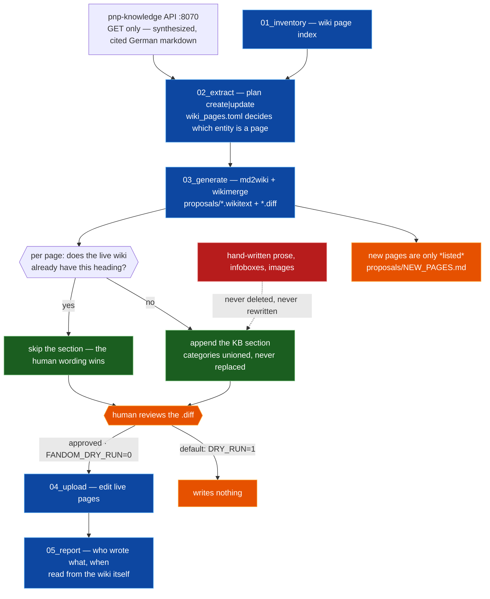

# pnp-export-data

```
Part of a three-repo pipeline:  pnp-crawl (private) → pnp-knowledge → pnp-export-data
                                 audio → transcript    transcript → knowledge    knowledge → wiki
```

The **output** stage: a CLI pipeline that keeps a live Fandom/MediaWiki wiki in
sync with a knowledge base, without an LLM and without ever deleting a word a
human wrote.

> **Stage 1 (`pnp-crawl`) is private by design.** The session recordings themselves are public, but the pipeline derives speaker voice embeddings — biometric templates tied to named individuals (GDPR Art. 9) — plus the local roster mapping people to characters and sessions. Deriving that data from public audio does not make it public, so the stage that holds it is not published.

## Two decisions worth reading first

### 1. The LLM was removed on purpose

The upstream KB (`pnp-knowledge`) already serves **synthesized, cited German
markdown** per concept. Once that is true, generating wiki prose with a model
buys nothing and costs correctness — so this stage has none
([md2wiki.py](md2wiki.py) converts markdown → Wikitext with a few regexes).

What that removal bought:

- **It cannot hallucinate.** The output is a mechanical transform of text that
  was already reviewed and cited upstream.
- **Re-runs are free.** A full sync costs HTTP round trips, no tokens — which
  is why the pipeline is safe to run on every KB change.
- **It is trivially testable.** 67 offline tests cover the conversion, the
  planner and the merge with no network, no wiki and no model.
- **It is reproducible.** Same KB state in, same bytes out — so the `.diff`
  a reviewer approves is the diff that gets uploaded.

The remaining cost control is HTTP: stage 2 caches the concept bodies its
planning call already returned (`wiki_cache/bodies.json`), stage 3 reads live
pages in batches of 50, and stage 4 skips proposals whose `.diff` is empty.

### 2. Updates are an additive merge, never a replace

Live wiki pages are hand-curated — infoboxes, images, human
prose, categories. A generated page that replaces them destroys all of it. So
[wikimerge.py](wikimerge.py) merges instead:

- The live page is kept **verbatim**. Nothing hand-written is ever deleted.
- Only KB sections whose heading is **not already on the live page** are
  appended. Heading matching is case-, whitespace- and *level*-insensitive, so
  a hand-written `=== Überblick ===` blocks the KB's `Überblick` — the bug that
  fix prevents is appending a whole article to itself on every sync.
- Generated content lives inside a marked **KI region** (`<!-- KI-Abschnitt … sha=… -->`)
  carrying a checksum of what the pipeline last wrote there. On the next sync:
  checksum matches → the region is ours to regenerate; checksum differs → a
  human edited it, the page is left completely untouched and the human text is
  harvested to `harvest/` so it can reach the KB before anything overwrites it.
- Categories are **unioned**, live order first.
- The KB's `# Belege` citation list is dropped; the wiki cites inline instead,
  each `[P-08]` marker resolved to that episode's own wiki page.
- **The agent never creates pages.** New ones are listed in
  `proposals/NEW_PAGES.md` for a human to create; the next sync fills them
  through the update path.

The `.diff` a reviewer sees is therefore additions-only. Redundant sections (a
human "Persönlichkeit" and a KB one worded differently) both survive and the
reviewer trims the overlap — a machine guessing which one to keep is exactly
the failure mode this design refuses.

## Pipeline

Input is the read-only **KB API** of `pnp-knowledge` (`config.KB_URL`, default
`http://127.0.0.1:8070`) — not local files.



**No LLM appears in this diagram, and that is the feature** — see decision 1
above. Re-running any stage costs HTTP round trips and zero tokens.

```
01_inventory.py  wiki → page index in wiki_cache/       what already exists
02_extract.py    KB API + wiki_pages.toml vs. index     create|update plan
                 → entities.json + bodies.json          deterministic, no LLM
03_generate.py   plan + KB bodies → proposals/          md2wiki + wikimerge:
                                                        .wikitext per page,
                                                        .diff for updates,
                                                        NEW_PAGES.md
04_upload.py     reviewed proposals/ → wiki             gated, see below
05_report.py     wiki + run logs → reports/ki_pages.*   md / csv / html / json
```

Every stage is idempotent — re-running after a KB change is safe.

**Stage 5** ([05_report.py](05_report.py), [report_html.py](report_html.py))
answers "which pages did the KI write, when was each last touched, which need a
human?" It reads the bot account's contributions from the wiki itself (the wiki
knows about every run; this machine only about its own) and emits a
paste-ready table, a CSV with an empty *Zuständig* column for assigning work,
and a self-contained HTML page with the texts readable inline. Read-only.

Supporting modules: [wiki_client.py](wiki_client.py) (MediaWiki Action API —
bot login, `all_pages`, batched `read_many`, `edit`; `edit()` honours
`DRY_RUN`), [pagemap.py](pagemap.py) (the entity→page map),
[md2wiki.py](md2wiki.py), [wikimerge.py](wikimerge.py), and
[runlog.py](runlog.py) (one JSONL event file per run under `logs/` — since
`proposals/` is flat, the run log is the only record of which run wrote which
file and why; the `merge` event per page makes a bad merge visible from one
line).

## Entities are not pages (`wiki_pages.toml`)

The knowledge base is a graph and wants one node per entity — a thousand of
them, down to a single undead army. The wiki is a reference work and wants
readable articles. [wiki_pages.toml](wiki_pages.toml) is the only place that
translates between the two, and it lives **here**, not in `pnp-knowledge`: a
merge that exists purely for readability has no business in the system of
record (ADR-001).

Only **exceptions** are listed. Everything unnamed stays a page of its own, and
`config.MIN_SESSIONS` (default 2) already keeps the long tail off the wiki — a
concept earns an article only once it appears in at least that many distinct
sessions, counted from the `Session <date>` citations in its KB body. Pages
that already exist live are never filtered: a human created it, and that
decision beats the threshold.

```toml
exclude = ["events/beschwoerung_von_slix"]   # gar keine Seite

[pages."Belorus der Stille"]                 # 1:N, ein Leitknoten
lead = ["npcs/belorus"]
sub  = ["factions/belorus_untotenarmee"]     # nur ein Abschnitt dort

[pages."Die fünf Seelen Vhar'Zuls"]          # 1:N, alle gleichwertig
lead = ["deities/kollmereth", "deities/thyrex", "deities/ezhura", "npcs/slix_vasul"]
```

`lead` carries the page's identity (type, category, aliases, attribution of
harvested human text); `sub` only ever appears as a section on it. Links to a
merged-away concept land automatically on the page that now covers it. After
any change, re-run `02_extract.py` and `03_generate.py`; the run log reports
`member_has_live_page` when a page orphaned by the change needs a redirect.

## The review gate

`FANDOM_DRY_RUN` defaults to `1`: nothing is **ever** written to the wiki.
Stage 4 only prints what it *would* upload. Writing requires **both**
`python 04_upload.py --apply` **and** `FANDOM_DRY_RUN=0`, and goes through a
bot account (Special:BotPasswords).

## Setup

```bash
python -m venv fandom_env
fandom_env\Scripts\activate          # Windows
pip install -r requirements.txt
pip install -r requirements-dev.txt  # tests
cp .env.example .env                 # then fill in bot account + wiki URL
```

The KB API must be running for stages 2–3:
`cd ../pnp-knowledge/services/kb && python -m pnp_okf.api`

## Tests

```bash
python -m pytest
```

Fully offline — no network, no wiki, no KB API, no model.
[test_export.py](test_export.py) covers the converter, the page map and the
stage-2/3 cores; [test_wikimerge.py](test_wikimerge.py) covers the additive
merge and the KI-region state machine; [test_runlog.py](test_runlog.py) covers
the run log and the stage-3 anomaly detectors. CI runs them on every push
([.github/workflows/ci.yml](.github/workflows/ci.yml)).

## License

MIT — see [LICENSE](LICENSE). The campaign content itself is not covered.
